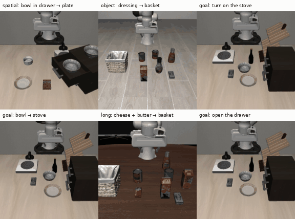
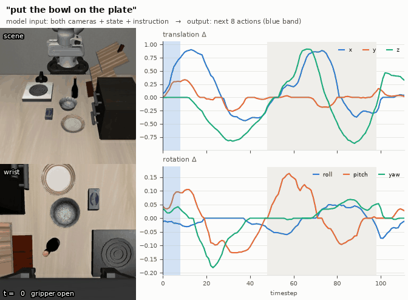
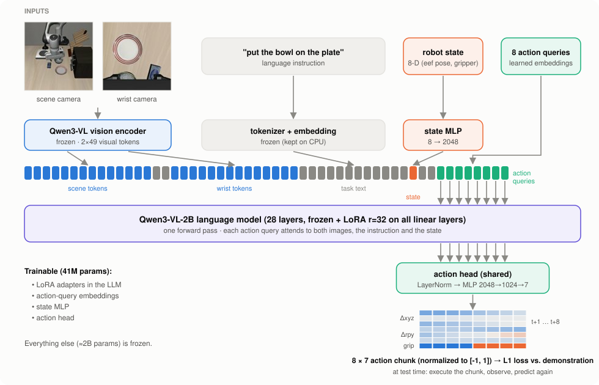
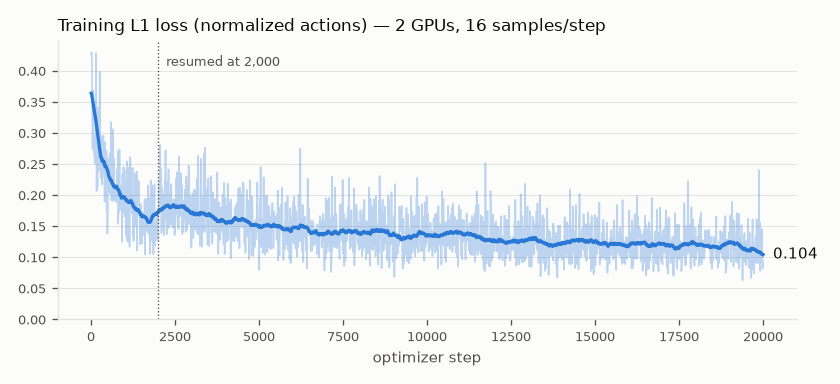

# vla-qwen

A compact **vision-language-action (VLA)** policy built on **Qwen3-VL-2B-Instruct**, fine-tuned with LoRA on the
[LIBERO](https://libero-project.github.io/) robot-manipulation benchmark. Given two camera views, the robot state and a
natural-language instruction, it predicts the next **8 robot actions in a single forward pass**
(OpenVLA-OFT-style parallel decoding with an L1 regression head — no action tokenization, no autoregressive sampling).

<p align="center">
  
  <br><em>The trained policy acting in the LIBERO simulator: 96% average success across the four LIBERO suites (<a href="#results">details</a>)</em>
</p>

<p align="center">
  
</p>

## Model

<p align="center">
  
</p>

- **Inputs:** scene camera + wrist camera (224×224), task instruction, 8-D robot state (end-effector pose + gripper).
- **Action queries:** 8 placeholder tokens whose embeddings are swapped for learned vectors through a forward hook on the
  embedding layer. Qwen3-VL's own image-token handling and M-RoPE are left untouched.
- **Output:** the LLM hidden state at each query → shared MLP → one 7-D action (Δxyz, Δroll/pitch/yaw, gripper), normalized
  to [-1, 1] by the 1st/99th percentiles of the training data.
- **Trainable:** 41M parameters (LoRA r=32 on every attention/MLP projection of the LLM, plus the queries, state MLP and head).
  The ≈2B base weights stay frozen.

## Data

LIBERO demonstrations from [`physical-intelligence/libero`](https://huggingface.co/datasets/physical-intelligence/libero):
**1,693 episodes · 273k frames · 40 tasks** across the four suites (Spatial, Object, Goal, Long).

<p align="center">
  
</p>

Each training sample is one frame plus the 8 actions that follow it (blue band). The gray background marks the stretch
where the gripper is closed:


## Training

<p align="center">
  
</p>

Two runs, back to back:

- **First run (2,000 steps ≈ 0.12 epochs, ~3.7 h):** the 250-step average L1 loss fell from 0.300 to 0.154.
- **Long run (resumed from step 2,000 up to 20,000; ≈ 1.2 epochs in total, ~29 h):** the 1,000-step average fell to
  0.117. The small bump just after step 2,000 comes from the restart: the optimizer state is fresh and the learning
  rate warms up again. Checkpoints are saved every 1,000 steps.

Trained on 2× RTX A2000 (6 GB each) with DDP: batch 1 per GPU × 8 accumulation steps = 16 samples per step, AdamW,
lr 2e-4 with cosine decay, light image augmentation (random crop + brightness/contrast jitter). Peak memory is
~4.3 GB per GPU. Gradient checkpointing is on, vocab logits are never computed, and the frozen 620 MB token-embedding
table is kept in CPU RAM.

## Results

Closed-loop success rate in the LIBERO simulator (`eval_libero.py`, 10 episodes per task, 40 tasks, 400 episodes per
checkpoint):

| Suite | 2,000 steps | **20,000 steps** | Notes on the 20,000-step checkpoint |
|---|---|---|---|
| LIBERO-Spatial | 55% | **98%** | 8 tasks at 10/10. The cookie-box layouts (1/10 before) are now 10/10 |
| LIBERO-Object | 71% | **100%** | every object 10/10 |
| LIBERO-Goal | 45% | **99%** | drawer opening and plate pushing went from 0/10 to 10/10. One miss on "wine bottle on top of the cabinet" |
| LIBERO-Long | 10% | **87%** | weakest: "bowl in bottom drawer and close it" 6/10, "two mugs on two plates" 7/10 |
| **Average** | 45.2% | **96.0%** | |

<p align="center">
  
</p>

The clip shows tasks the 2,000-step checkpoint could not do at all, plus a typical remaining failure. Training ten times
longer (still only ~1.2 epochs) closed almost every gap: the motions that are rare in the data (drawers, pushing) now
work, and the long two-stage tasks went from 10% to 87%. The remaining failures are mostly on long tasks that end by
closing a drawer or place two objects precisely.

These numbers use 10 episodes per task. The official LIBERO protocol uses 50, so treat differences of a few points as
noise. For reference, published OpenVLA-OFT (7B) reports 97.1% average with 50 episodes per task.

## Files

| File | Purpose |
|---|---|
| `vla.py` | Model: Qwen3-VL + LoRA, learned action-query / state embeddings, MLP action head |
| `prepare_data.py` | Downloads LIBERO and converts it to fast memmapped arrays (`data/libero`) |
| `train.py` | Single- or multi-GPU (DDP) training |
| `viz_samples.py` | Renders `samples.png` |
| `eval_libero.py` / `run_eval.sh` | Closed-loop evaluation in the LIBERO simulator (success rate + rollout videos) |
| `make_media.py` | Renders the README figures in `media/` (architecture, GIFs, loss curve) |

## Usage

```bash
python prepare_data.py --res 224 --workers 12         # ~33 GB download → ~80 GB memmap
python viz_samples.py --n 4 --out samples.png
torchrun --nproc_per_node 2 train.py --bs 1 --accum 8 --steps 2000 --warmup 100 --save_every 500
torchrun --nproc_per_node 2 train.py --bs 1 --accum 8 --steps 20000 --warmup 100 --save_every 1000 \
    --resume runs/qwen3vl2b_libero_2k/ckpt_002000.pt --out runs/qwen3vl2b_libero_20k
python make_media.py --log runs_2k.log,runs_20k.log   # regenerate README figures
```

### Simulator evaluation

LIBERO needs older simulator packages (robosuite 1.4.1, MuJoCo 3.x), so it lives in a separate copy of the env:

```bash
conda create -p ./.env-libero --clone ./.env
git clone --depth 1 https://github.com/Lifelong-Robot-Learning/LIBERO.git third_party/LIBERO
.env-libero/bin/pip install "robosuite==1.4.1" "mujoco==3.3.0" "bddl==1.0.1" easydict "gym==0.25.2" future \
    opencv-python-headless imageio imageio-ffmpeg
mkdir -p third_party/libero_cfg   # config.yaml pointing at third_party/LIBERO/libero/libero/{bddl_files,init_files,assets}
GPU=0 ./run_eval.sh --ckpt runs/qwen3vl2b_libero_20k/ckpt_020000.pt --trials 10   # official protocol: --trials 50
# split across GPUs: GPU=0 ... --suites libero_spatial,libero_10 --out <dir_a> & GPU=1 ... --suites libero_object,libero_goal --out <dir_b>
```

Tested with torch 2.11.0+cu128, transformers 5.23 and peft 0.21.
