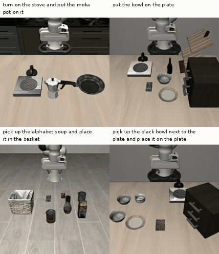

# vla-qwen

A compact **vision-language-action (VLA)** policy built on **Qwen3-VL-2B-Instruct**, fine-tuned with LoRA on the
[LIBERO](https://libero-project.github.io/) robot-manipulation benchmark. Given two camera views, the robot state and a
natural-language instruction, it predicts the next **8 robot actions in a single forward pass**
(OpenVLA-OFT-style parallel decoding with an L1 regression head — no action tokenization, no autoregressive sampling).

<p align="center">
  
</p>

## Model

<p align="center">
  
</p>

- **Inputs:** scene camera + wrist camera (224×224), task instruction, 8-D robot state (end-effector pose + gripper).
- **Action queries:** 8 placeholder tokens whose embeddings are swapped for learned vectors through a forward hook on the
  embedding layer. Qwen3-VL's own image-token handling and M-RoPE are left untouched.
- **Output:** the LLM hidden state at each query → shared MLP → one 7-D action (Δxyz, Δroll/pitch/yaw, gripper), normalized
  to [-1, 1] by the 1st/99th percentiles of the training data.
- **Trainable:** 41M parameters (LoRA r=32 on every attention/MLP projection of the LLM, plus the queries, state MLP and head).
  The ≈2B base weights stay frozen.

## Data

LIBERO demonstrations from [`physical-intelligence/libero`](https://huggingface.co/datasets/physical-intelligence/libero):
**1,693 episodes · 273k frames · 40 tasks** across the four suites (Spatial, Object, Goal, Long).

<p align="center">
  
</p>

Each training sample is one frame plus the 8 actions that follow it (blue band). The gray background marks the stretch
where the gripper is closed:


## Training

<p align="center">
  
</p>

**First run (2,000 steps ≈ 0.12 epochs, ~3.7 h):** the 250-step average L1 loss fell from 0.300 to 0.154.
Checkpoints were saved every 500 steps.

Trained on 2× RTX A2000 (6 GB each) with DDP: batch 1 per GPU × 8 accumulation steps = 16 samples per step, AdamW,
lr 2e-4 with cosine decay, light image augmentation (random crop + brightness/contrast jitter). Peak memory is
~4.3 GB per GPU. Gradient checkpointing is on, vocab logits are never computed, and the frozen 620 MB token-embedding
table is kept in CPU RAM.

**Rollout videos in the LIBERO simulator:** coming once the evaluation script is in place.

## Files

| File | Purpose |
|---|---|
| `vla.py` | Model: Qwen3-VL + LoRA, learned action-query / state embeddings, MLP action head |
| `prepare_data.py` | Downloads LIBERO and converts it to fast memmapped arrays (`data/libero`) |
| `train.py` | Single- or multi-GPU (DDP) training |
| `viz_samples.py` | Renders `samples.png` |
| `eval_libero.py` / `run_eval.sh` | Closed-loop evaluation in the LIBERO simulator (success rate + rollout videos) |
| `make_media.py` | Renders the README figures in `media/` (architecture, GIFs, loss curve) |

## Usage

```bash
python prepare_data.py --res 224 --workers 12         # ~33 GB download → ~80 GB memmap
python viz_samples.py --n 4 --out samples.png
torchrun --nproc_per_node 2 train.py --bs 1 --accum 8 --steps 2000 --warmup 100 --save_every 500
python make_media.py --log runs_2k.log                # regenerate README figures
```

### Simulator evaluation

LIBERO needs older simulator packages (robosuite 1.4.1, MuJoCo 3.x), so it lives in a separate copy of the env:

```bash
conda create -p ./.env-libero --clone ./.env
git clone --depth 1 https://github.com/Lifelong-Robot-Learning/LIBERO.git third_party/LIBERO
.env-libero/bin/pip install "robosuite==1.4.1" "mujoco==3.3.0" "bddl==1.0.1" easydict "gym==0.25.2" future \
    opencv-python-headless imageio imageio-ffmpeg
mkdir -p third_party/libero_cfg   # config.yaml pointing at third_party/LIBERO/libero/libero/{bddl_files,init_files,assets}
GPU=0 ./run_eval.sh --ckpt runs/qwen3vl2b_libero_2k/ckpt_002000.pt --trials 10   # official protocol: --trials 50
```

Tested with torch 2.11.0+cu128, transformers 5.23 and peft 0.21.
