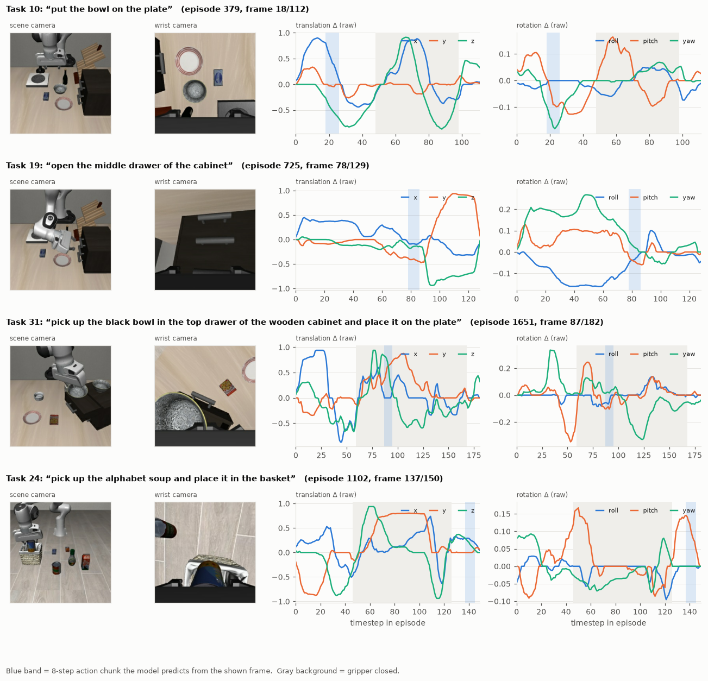

# vla-qwen

OpenVLA-OFT-style vision-language-action model built on **Qwen3-VL-2B-Instruct** (LoRA), trained on LIBERO.

```
[scene img][wrist img] "Task: ..." <state> <act_1> ... <act_8>  ->  Qwen3-VL-2B (LoRA)
hidden(act_i) -> MLP -> action_{t+i}  (7-D, normalized to [-1,1]), L1 loss
```

| File | Purpose |
|---|---|
| `vla.py` | Model: learned action-query / state embeddings swapped in via an embedding hook, MLP action head |
| `prepare_data.py` | Downloads `physical-intelligence/libero` and converts to memmapped arrays (`data/libero`) |
| `train.py` | Single- or multi-GPU (DDP) training |
| `viz_samples.py` | Renders sample frames + action trajectories (`samples.png`) |

## Usage

```bash
python prepare_data.py --res 224 --workers 12
python viz_samples.py --n 4 --out samples.png
torchrun --nproc_per_node 2 train.py --bs 1 --accum 8 --steps 2000 --warmup 100 --save_every 500
```

Tested with torch 2.11.0+cu128, transformers 5.23, peft 0.21 on 2x RTX A2000 (6 GB): bs=1 peaks at ~4.3 GB/GPU
(the frozen token-embedding table is kept on CPU to fit).


